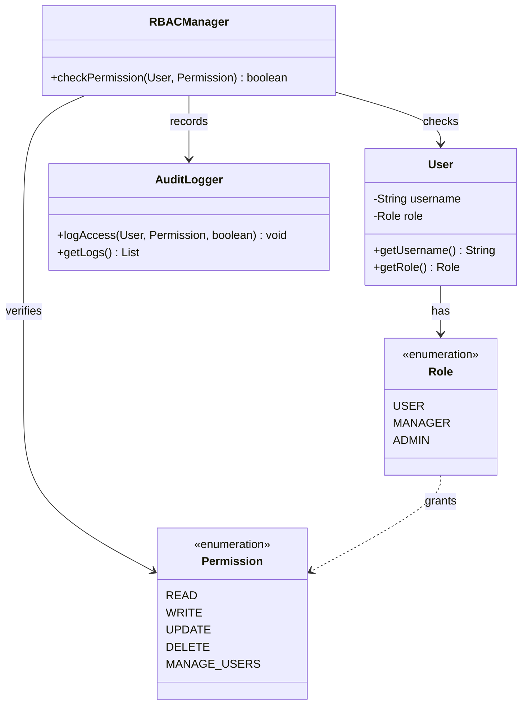
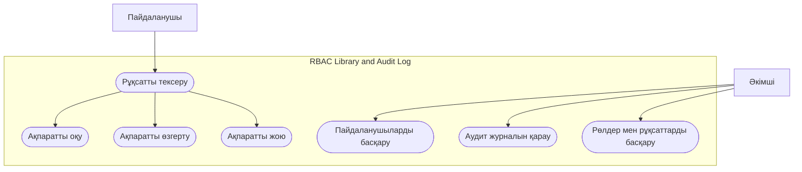
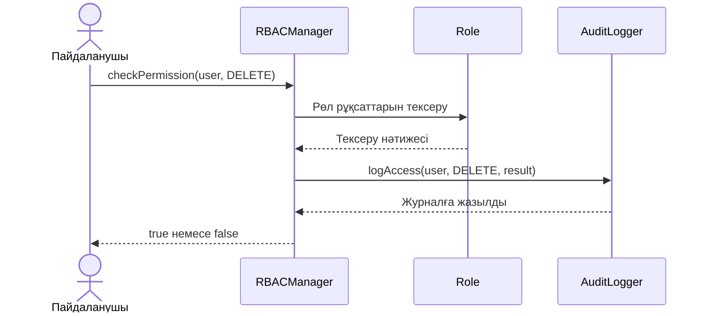
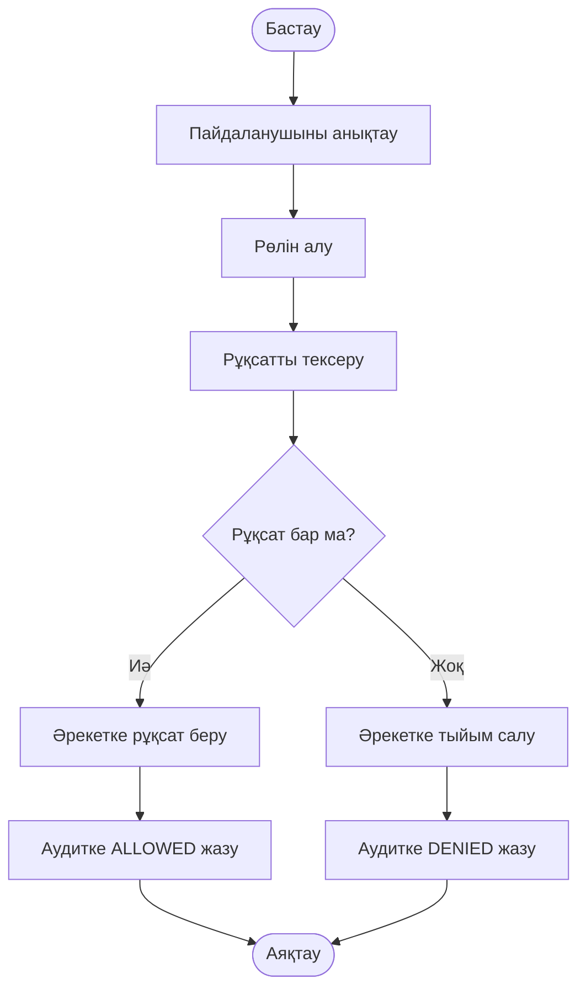

# RBAC Library and Audit Log

**Java 17 · Maven · JUnit 5 · GitHub**

RBAC Library and Audit Log — Java тілінде жасалған рөлдерге негізделген қолжетімділікті басқару кітапханасы. Жүйе пайдаланушының рөліне қарай рұқсаттарды тексереді және әрбір тексерудің нәтижесін аудит журналына тіркейді.

## 1. Жобаның мақсаты

Жобаның мақсаты — пайдаланушылардың құқықтарын рөлдер арқылы басқару, рөлдер иерархиясын құру және қауіпсіздік мақсатында әрбір рұқсат тексеруін журналға тіркеу.

## 2. Жобаның міндеттері

- Пайдаланушыларға рөл тағайындау.
- Рөлдер мен рұқсаттарды анықтау.
- Рөлдер иерархиясын жүзеге асыру.
- Пайдаланушының әрекетке рұқсатын тексеру.
- Әрбір тексерудің нәтижесін аудит журналына жазу.
- JUnit 5 арқылы бағдарламаны тестілеу.

## 3. Қолданылатын технологиялар

| Технология | Мақсаты |
|---|---|
| Java 17 | Бағдарламаның негізгі тілі |
| Apache Maven | Жобаны құрастыру және кітапханаларды басқару |
| JUnit 5 | Автоматты тестілеу |
| Git және GitHub | Кодты сақтау және нұсқаларды басқару |
| Mermaid | UML диаграммаларын көрсету |

## 4. Негізгі мүмкіндіктері

### Рөлдер

- `USER` — қарапайым пайдаланушы.
- `MANAGER` — басқарушы, USER рөлінің рұқсаттарын да иеленеді.
- `ADMIN` — әкімші, MANAGER және USER рөлдерінің рұқсаттарын да иеленеді.

### Рұқсаттар

| Рұқсат | Сипаттамасы |
|---|---|
| `READ` | Ақпаратты оқу |
| `WRITE` | Жаңа ақпарат енгізу |
| `UPDATE` | Ақпаратты өзгерту |
| `DELETE` | Ақпаратты жою |
| `MANAGE_USERS` | Пайдаланушыларды басқару |

### Аудит журналы

Әрбір рұқсатты тексергенде жүйе келесі ақпаратты тіркейді:

- Тексеру күні мен уақыты.
- Пайдаланушының аты.
- Пайдаланушының рөлі.
- Сұралған рұқсат.
- Нәтиже: `ALLOWED` немесе `DENIED`.

## 5. Жоба құрылымы

```text
RBAC-Library/
├── pom.xml
├── README.md
└── src/
    ├── main/java/com/example/rbac/
    │   ├── Permission.java
    │   ├── Role.java
    │   ├── User.java
    │   ├── AuditLogger.java
    │   ├── RBACManager.java
    │   └── Main.java
    └── test/java/com/example/rbac/
        └── RBACManagerTest.java
```

### Файлдардың міндеті

- `Permission.java` — рұқсат түрлерін анықтайды.
- `Role.java` — рөлдер мен олардың иерархиясын сипаттайды.
- `User.java` — пайдаланушының ақпаратын сақтайды.
- `AuditLogger.java` — рұқсат тексерулерінің нәтижелерін журналға жазады.
- `RBACManager.java` — рұқсаттарды тексереді.
- `Main.java` — бағдарламаны іске қосады.
- `RBACManagerTest.java` — JUnit 5 тесттерін қамтиды.
- `pom.xml` — Maven баптаулары мен тәуелділіктерін сақтайды.

## 6. Орнату және іске қосу

### Қажетті құралдар

- JDK 17 немесе одан жоғары.
- Apache Maven.
- IntelliJ IDEA немесе басқа Java редакторы.

### Репозиторийді жүктеу

```bash
git clone <REPOSITORY_URL>
cd RBAC-Library
```

`<REPOSITORY_URL>` орнына GitHub репозиторийінің сілтемесін қойыңыз.

### Жобаны құрастыру

```bash
mvn clean compile
```

### Тесттерді іске қосу

```bash
mvn test
```

Бағдарламаны IntelliJ IDEA ішінен `Main.java` файлын іске қосу арқылы орындауға болады.

## 7. Тестілеу

JUnit 5 арқылы келесі жағдайлар тексеріледі:

1. ADMIN рөлінде DELETE рұқсаты бар.
2. USER рөлінде DELETE рұқсаты жоқ.
3. MANAGER рөлі USER рөлінің READ рұқсатын мұрагерлік арқылы алады.
4. ADMIN төменгі рөлдердің рұқсаттарын иеленеді.
5. Әрбір рұқсат тексеруі аудит журналына жазылады.
6. ALLOWED және DENIED нәтижелері тіркеледі.

## 8. UML диаграммалары

### 8.1 Class Diagram — Кластар диаграммасы



**Түсіндірме:** User пайдаланушыны, Role рөлді, Permission рұқсат түрлерін көрсетеді. RBACManager рұқсатты тексереді, ал AuditLogger нәтижені тіркейді.

### 8.2 Use Case Diagram — Қолдану жағдайлары



**Түсіндірме:** пайдаланушы рұқсаттарды тексереді және өз рөліне сәйкес әрекеттерді орындайды. Әкімші пайдаланушыларды, рөлдерді және аудит журналын басқара алады.

### 8.3 Sequence Diagram — Рұқсатты тексеру реті



**Түсіндірме:** RBACManager рұқсатты тексереді, нәтижені аудит журналына жазады және шақырушыға true немесе false қайтарады.

### 8.4 Activity Diagram — Жұмыс алгоритмі



**Түсіндірме:** жүйе рұқсаттың бар-жоғын тексеріп, нәтижеге сәйкес әрекетке рұқсат береді немесе тыйым салады. Екі нәтиже де журналға жазылады.

## 9. Күтілетін нәтиже

- Рөлге байланысты рұқсаттарды тексеру.
- Рөлдер иерархиясын қолдау.
- Рұқсатсыз әрекеттерге тыйым салу.
- Тексеру нәтижелерін аудит журналына тіркеу.
- JUnit 5 тесттері арқылы негізгі функцияларды тексеру.

## 10. Болашақта дамыту

- Аудит журналын файлға немесе дерекқорға сақтау.
- Жаңа рөлдер мен рұқсаттарды қосу.
- Аудит жазбаларын іздеу және сүзгілеу.
- Қосымша интеграциялық тесттер жасау.
- Жүйені веб-қосымшаға біріктіру.

## Қорытынды

RBAC Library and Audit Log — рөлдерге негізделген қолжетімділікті басқару қағидаларын үйренуге арналған Java жобасы. Ол рөлдер иерархиясын, рұқсаттарды тексеруді және аудит журналын жүргізуді қарастырады.

**Автор:** Рустем Байжума  
**Жоба түрі:** Java оқу жобасы

> Ескерту: диаграммалар жобаның сипаттамасына негізделген. Әдістердің нақты атаулары мен рөлдердің рұқсаттары бастапқы Java кодына сәйкес болуы керек.
